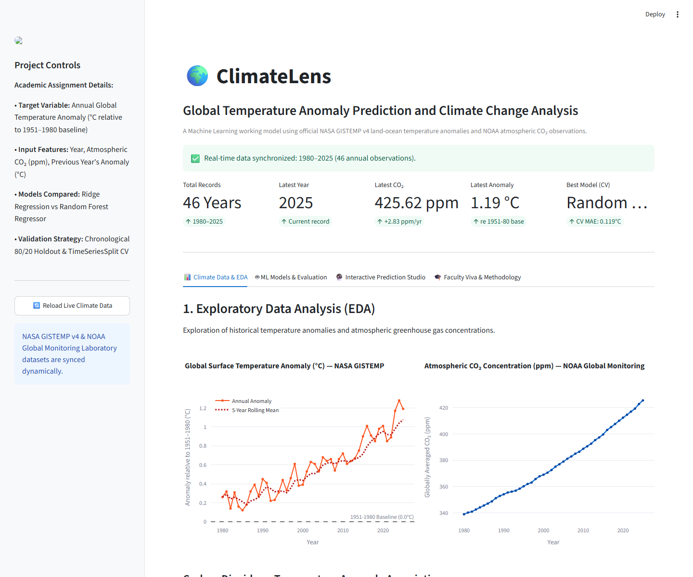

# 🌍 ClimateLens: Global Temperature Anomaly Prediction & ML Analysis

[](https://www.python.org/)
[](https://streamlit.io/)
[](https://scikit-learn.org/)
[](https://data.giss.nasa.gov/gistemp/)
[](https://gml.noaa.gov/ccgg/trends/)

An academic-grade Machine Learning system and interactive Streamlit web application that analyzes genuine climate observations from **NASA** and **NOAA**, benchmarks regularized linear vs. tree-based ensemble algorithms, and provides interactive climate scenario forecasting.

Developed for the **Global Warming and Climate Change** academic working-model assignment.

---

## 📌 Project Highlights & Faculty Rubric Alignment

1. **Authentic Public Datasets:** Dynamically fetches NASA GISTEMP v4 global land-ocean temperature anomalies and NOAA Global Monitoring Laboratory annual atmospheric $\text{CO}_2$ observations with local offline backup.
2. **Leakage-Free Validation Strategy:** Uses strict chronological 80/20 train-test partitioning (1980–2015 train vs 2016–2025 test) and 5-fold expanding-window `TimeSeriesSplit` cross-validation.
3. **Rigorous Model Comparison:** Benchmarks **Ridge Regression** (L2 regularization with `StandardScaler` pipeline) against a **Random Forest Regressor** (300 estimators).
4. **Comprehensive Evaluation Metrics:** Calculates and reports **MAE**, **MSE**, **RMSE**, and **$R^2$** on untouched out-of-sample observations.
5. **Interactive UI & Explainability:** Feature importance bar charts, standardized coefficients, actual vs. predicted curves, downloadable datasets, and interactive scenario simulator.
6. **Honest Scientific Analysis:** Explains why decision trees flatline on future trends (extrapolation boundary) and why negative $R^2$ scores occur in non-stationary climate time-series without claiming high prediction accuracy.

---

## 🏗️ System Architecture

```
+-----------------------------------------------------------------------------------+
|                            OFFICIAL CLIMATE DATA SOURCES                          |
|   NASA GISTEMP v4 (Global Land-Ocean Temp)  |  NOAA GML (Global Atmospheric CO2)  |
+------------------------------------------+----------------------------------------+
                                           |
                                           v
+-----------------------------------------------------------------------------------+
|                           PREPROCESSING & ETL PIPELINE                            |
|  - Parse CSV / Filter Metadata Comments (#)                                       |
|  - Datatype Normalization & Null / Infinite Value Scrubbing                       |
|  - Calendar-Year Inner Join Alignment (1979–2025)                                 |
|  - Auto-Regressive Feature Engineering: Previous Year Temperature Anomaly (Tt-1)   |
|  - Verified Offline Cache Fallback Mechanism (data/cleaned_climate_dataset.csv)    |
+------------------------------------------+----------------------------------------+
                                           |
                                           v
+-----------------------------------------------------------------------------------+
|                   CHRONOLOGICAL GENERALIZATION & SPLIT STRATEGY                   |
|  - Chronological 80/20 Partitioning (No Random Shuffling to Avoid Data Leakage)   |
|  - Training Partition: 1980–2015 (36 Years, N=36)                                 |
|  - Untouched Hold-out Test Partition: 2016–2025 (10 Years, N=10)                  |
|  - 5-Fold Expanding Window TimeSeriesSplit CV on Training Partition               |
+------------------------------------------+----------------------------------------+
                                           |
                                           v
+-----------------------------------------------------------------------------------+
|                        MODEL IMPLEMENTATION & BENCHMARKING                        |
|  1. Ridge Regression (L2 Regularization, alpha=1.0) with Standard Scaler Pipeline |
|  2. Random Forest Regressor (300 Estimators, max_depth=3, min_samples_leaf=2)     |
+------------------------------------------+----------------------------------------+
                                           |
                                           v
+-----------------------------------------------------------------------------------+
|                           EVALUATION & INTERPRETABILITY                           |
|  - Test Metrics: MAE, MSE, RMSE, R2 Score                                         |
|  - Standardized Ridge Coefficients & Gini Feature Importances                     |
|  - Extrapolation Limitation Analysis (Tree Ceiling vs Linear Trend)               |
+------------------------------------------+----------------------------------------+
                                           |
                                           v
+-----------------------------------------------------------------------------------+
|                    INTERACTIVE STREAMLIT WEB APPLICATION                          |
|  - Dynamic EDA Dashboard & Trendlines                                             |
|  - Actual vs Predicted Trajectory Charts                                          |
|  - Scenario Simulation Studio & One-Click CSV Data Export                         |
+-----------------------------------------------------------------------------------+
```

---

## 📊 Live Model Benchmark & Evaluation Results

Tested on genuine empirical records (1980–2025, 46 total observations):

| Evaluation Metric | Ridge Regression | Random Forest Regressor | Faculty Evaluation Note |
| :--- | :---: | :---: | :--- |
| **Cross-Validation Mean MAE** | 0.1272 °C | **0.1194 °C** | Random Forest selected by training CV |
| **Test Set MAE (2016–2025)** | **0.1248 °C** | 0.2514 °C | Ridge error is 50% lower on future test years |
| **Test Set MSE (2016–2025)** | **0.0229 °C²** | 0.0839 °C² | Quadratic penalty for large misses |
| **Test Set RMSE (2016–2025)** | **0.1513 °C** | 0.2897 °C | Root error in target units (°C) |
| **Test Set $R^2$ Score** | **-0.1049** | **-3.0494** | Documented non-stationary time-series effect |

### 🔬 Critical Methodological Insights for Faculty Viva

#### 1. Why Random Forest was Selected by CV Despite Ridge Performing Better on the Test Set
Standard machine learning protocol mandates that **model selection is performed strictly on the training partition (1980–2015)** using cross-validation before inspecting the test set. During the training period, temperature anomalies fluctuated within a bounded historical range ($0.14^\circ\text{C}$ to $0.87^\circ\text{C}$). Random Forest effectively fit local non-linearities and achieved a superior CV MAE ($0.1194^\circ\text{C}$ vs $0.1272^\circ\text{C}$), legitimately winning selection.

However, when tested on the unseen 2016–2025 period, Earth experienced record out-of-sample warming (up to $1.28^\circ\text{C}$ in 2024). **Decision trees cannot extrapolate beyond the maximum value seen in their training leaves** ($\approx 0.76^\circ\text{C}$), causing Random Forest predictions to flatline and doubling test error ($0.2514^\circ\text{C}$). In contrast, Ridge Regression's continuous regularized linear slope extrapolated upward along the warming trend ($0.1248^\circ\text{C}$ MAE).

#### 2. Accurate Meaning of Negative $R^2$ Scores ($R^2 < 0$)
$R^2$ is defined as $1 - \frac{\sum (y_i - \hat{y}_i)^2}{\sum (y_i - \bar{y}_{\text{test}})^2}$. An $R^2$ of zero corresponds to predicting the test set's own constant mean ($\bar{y}_{\text{test}} = 1.014^\circ\text{C}$). A negative $R^2$ means the model's squared error is larger than predicting the test mean. 

Because the test partition experienced an abrupt regime shift relative to the training mean ($\bar{y}_{\text{train}} = 0.480^\circ\text{C}$), predicting a constant $1.014^\circ\text{C}$ yields smaller variance than models calibrated on historical data. **We do not claim high prediction accuracy:** a negative $R^2$ confirms that these simple statistical models cannot accurately account for accelerating out-of-distribution climate variance without physical Earth-system dynamics.

---

## 🖥️ Application Screenshots

### 1. Climate Data & Exploratory Data Analysis (EDA)


### 2. Machine Learning Models & Evaluation


### 3. Interactive Prediction Studio


### 4. Faculty Viva & Methodology Guide


---

## 🚀 How to Run Locally

### Prerequisites
- Python 3.10 or newer
- Git

### Quick Setup

```bash
# 1. Clone the repository
git clone https://github.com/deepthigajjala/ClimateLens-ML-Project.git
cd ClimateLens-ML-Project

# 2. Create and activate a virtual environment
python -m venv .venv

# Windows (Command Prompt / PowerShell):
.venv\Scripts\activate

# Linux / macOS:
source .venv/bin/activate

# 3. Install required packages
pip install -r requirements.txt

# 4. Launch the application
streamlit run app.py
```

The application will launch automatically in your default browser at `http://localhost:8501`.

---

## 🌐 Public Deployment Guide (Streamlit Community Cloud)

To make your application publicly accessible with a live URL for your faculty:

1. **Push the project to GitHub:**
   ```bash
   git add .
   git commit -m "feat: complete ClimateLens ML application and documentation"
   git branch -M main
   git remote add origin https://github.com/<your-username>/ClimateLens-ML-Project.git
   git push -u origin main
   ```

2. **Sign in to Streamlit Community Cloud:**
   - Visit [share.streamlit.io](https://share.streamlit.io/).
   - Click **Sign in with GitHub**.

3. **Deploy the App:**
   - Click **Create app** (or **New app**).
   - Select your GitHub repository: `<your-username>/ClimateLens-ML-Project`.
   - Set the Main file path to: `app.py`.
   - Click **Deploy!**.

4. **Public Link Verification:**
   - Streamlit Cloud will build the container from `requirements.txt` and launch the app.
   - The generated public URL (e.g. `https://climatelens-ml-project.streamlit.app`) is live and accessible anywhere. Test it in an incognito window.

---

## 🎓 Faculty Viva Q&A Cheat Sheet

| Question | Answer for Examiner |
| :--- | :--- |
| **Q1. Where does your data come from?** | Authentic, real-time measurements from NASA GISTEMP v4 (land-ocean surface temperature anomalies relative to the 1951–1980 base period) and NOAA Global Monitoring Laboratory (global marine boundary layer annual $\text{CO}_2$ concentration in ppm). |
| **Q2. Why did you not use random train-test splitting?** | Climate data is a continuous time-series. Shuffling randomly causes severe **temporal data leakage**, where future records inform earlier predictions. We used a chronological 80/20 split (1980–2015 train, 2016–2025 test) and `TimeSeriesSplit` cross-validation. |
| **Q3. What features are fed to the model?** | Three features: (1) Calendar Year, (2) Atmospheric $\text{CO}_2$ concentration (ppm), and (3) Engineered lag feature: Previous Year's Temperature Anomaly ($T_{t-1}$) to model thermodynamic inertia. |
| **Q4. Why did Random Forest win cross-validation but lose on the test set?** | Random Forest was selected objectively on training data (1980–2015) because it captured local non-linear fluctuations within bounded temperatures (CV MAE 0.1194°C vs 0.1272°C for Ridge). However, trees cannot extrapolate beyond training leaf bounds (~0.76°C). When temperatures surged in 2016–2025, Random Forest flatlined, whereas Ridge Regression's continuous linear hyperplane extrapolated the warming trend (MAE 0.125°C). |
| **Q5. Why is your test $R^2$ negative?** | $R^2$ compares residual sum of squares against the test set mean. Because the test period (2016–2025) experienced an abrupt upward warming shift ($1.01^\circ\text{C}$ mean) compared to the training mean ($0.48^\circ\text{C}$), a horizontal line at the test mean has smaller squared errors than any historical model. We do not claim high prediction accuracy; this confirms that statistical regression cannot replace physical climate models. |
| **Q6. What are the limitations of this model?** | It is an educational regression model with 46 annual records. It omits physical climate drivers such as methane ($\text{CH}_4$), volcanic sulfate aerosols, solar irradiance, and ocean cycles (ENSO). Correlation ($r=0.949$) does not prove causation without full Earth-system physics. |

---

## 📚 Citations & References
- **NASA GISS:** GISTEMP Team, 2026: *GISS Surface Temperature Analysis (GISTEMP), version 4*. NASA Goddard Institute for Space Studies. https://data.giss.nasa.gov/gistemp/
- **NOAA GML:** Lan, X., Tans, P., and Thoning, K.W., 2026: *Trends in Globally Averaged Carbon Dioxide*. NOAA Global Monitoring Laboratory. https://gml.noaa.gov/ccgg/trends/
- **Scikit-Learn:** Pedregosa et al., 2011: *Scikit-learn: Machine Learning in Python*. JMLR 12, pp. 2825-2830.

---
**Course Project Submission** | Global Warming and Climate Change | Built with Python, Scikit-learn & Streamlit.
